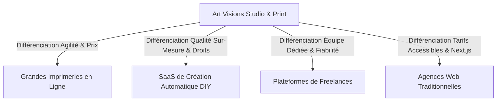

# ANALYSE DE LA CONCURRENCE SEO — FRANCE & BELGIQUE FRANCOPHONE (2026)
**Projet :** Art Visions ([https://art-visions.fr/](https://art-visions.fr/))  
**Auditeur :** Lead SEO Strategist & Technical Auditor  
**Marché de référence :** France métropolitaine & Wallonie / Bruxelles  

---

## 1. Cartographie des 4 Typologies de Concurrents sur les SERPs

Dans les résultats de recherche Google en France, Art Visions se positionne au carrefour de quatre grands groupes de compétiteurs :

---

## 2. Analyse Détaillée par Groupe de Concurrents

### Groupe 1 : Les Géants de l'Imprimerie en Ligne (VistaPrint, Onlineprinters, Saxoprint, Exaprint)
- **Forces :** Autorité de domaine historique massive (Domain Rating > 75), millions de backlinks, budgets publicitaires Google Ads considérables.
- **Faiblesses & Vulnérabilités constatées :**
  - Contenu textuel automatisé, froid, axé exclusivement sur des listes de spécifications sans conseil métier.
  - Outils en ligne rigides imposant des inscriptions obligatoires et des tunnels de commande fastidieux.
  - Tarifs de base affichés très bas mais alourdis par des options payantes de vérification de fichier, de délais ou de frais de livraison en fin de tunnel.
  - Service client délocalisé sans accompagnement graphique personnalisé.
- **Angle d'attaque Art Visions :** Articles de blog ultra-pédagogiques détaillant la technique PAO (fond perdu, traits de coupe, 300 DPI, profils FOGRA39) + mise à disposition d'outils interactifs gratuits et immédiats sans inscription (`gabarit-impression`, `calculateur-impression`).

### Groupe 2 : Les Outils SaaS DIY (Canva, Looka, Tailor Brands)
- **Forces :** Domination des requêtes débutantes (« créer logo gratuit », « modèle flyer »).
- **Faiblesses & Vulnérabilités constatées :**
  - Faux "gratuit" : les utilisateurs investissent du temps pour concevoir un document, avant d'être bloqués par un mur payant (paywall) au moment de l'export haute définition.
  - Logos basés sur des cliparts préexistants interdits de dépôt à l'INPI et non protégeables juridiquement.
  - Fichiers d'export non adaptés aux normes d'imprimerie offset industrielle (absence de traits de coupe vectoriels et de profil CMJN natif sans abonnement Pro).
- **Angle d'attaque Art Visions :** Démontrer la différence fondamentale entre un logo amateur non protégeable et une véritable identité vectorielle sur-mesure cédée en pleine propriété, tout en offrant des studios gratuits éthiques et utilisables sans restriction.

### Groupe 3 : Les Plateformes de Freelances (Malt, Graphiste.com, Fiverr)
- **Forces :** Fort positionnement sur les requêtes d'intention de mise en relation (« graphiste freelance », « trouver un webdesigner »).
- **Faiblesses & Vulnérabilités constatées :**
  - Qualité très hétérogène des prestataires, risque deテンプレート reconditionnés, retards de livraison fréquents.
  - Pas de chaîne graphique complète (un graphiste indépendant ne fabrique pas vos enseignes physiques ni n'imprime vos 5 000 brochures).
- **Angle d'attaque Art Visions :** Présenter la force d'un studio intégré réunissant directeurs artistiques, imprimeurs expérimentés et développeurs web sous un interlocuteur unique avec des garanties contractuelles.

### Groupe 4 : Les Agences de Communication Traditionnelles
- **Forces :** Présence locale et réseau d'affaires institutionnel.
- **Faiblesses & Vulnérabilités constatées :**
  - Devis très élevés (> 4 000 € pour un logo, > 10 000 € pour un site web vitrine) inabordables pour les créateurs d'entreprise et commerces de quartier.
  - Sites web lents sous WordPress vieillissants avec des scores Google PageSpeed mobiles médiocres (< 50/100).
  - Lenteur opérationnelle et absence totale d'outils gratuits en libre-service.
- **Angle d'attaque Art Visions :** Proposer la performance technologique de 2026 (architecture Next.js ultra-rapide, scores 95-100, sécurité native sans plugins vulnérables) à des forfaits clairs et transparents.

---

## 3. Synthèse des Opportunités Clés à Préempter

1. **Le secteur CHR & Commerces de quartier en France :** C'est le segment le plus délaissé par les agences haut de gamme. Les restaurateurs ont un besoin quotidien de menus, grilles de prix, cartes de fidélité et affichages réglementaires.
2. **Le respect des normes légales françaises :** Citer et expliquer l'Arrêté du 27 mars 1987 (coiffure), le Décret du 26 janvier 2022 (origine des viandes), les règles INPI et la TLPE installe une autorité que les concurrents internationaux ne peuvent égaler.
3. **La technologie Next.js vs WordPress :** Positionner Art Visions comme l'agence moderne de référence pour les entreprises fuyant les failles de sécurité et la lenteur des anciens CMS.
