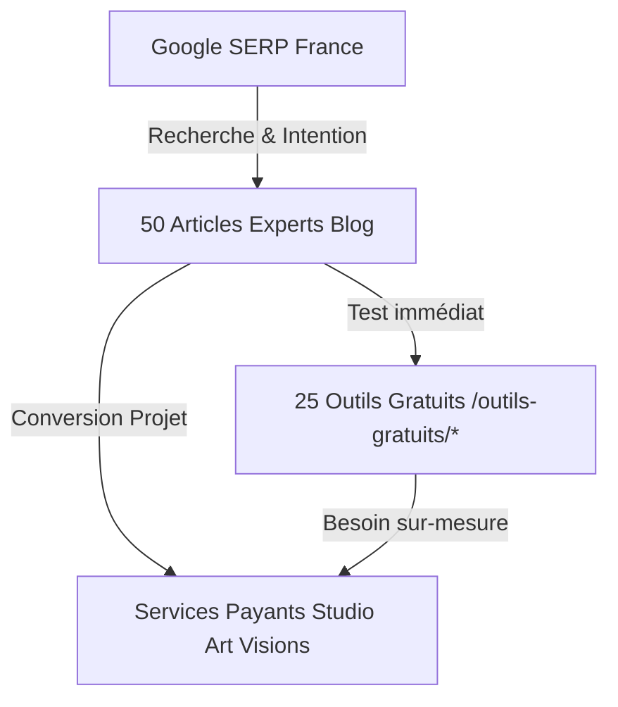

# ART VISIONS — RAPPORT DE DÉPLOIEMENT SEO & 50 ARTICLES PREMIUM

**Date :** 15 Octobre 2026  
**Domaine :** [https://art-visions.fr/](https://art-visions.fr/)  
**Marché principal :** France | **Marché secondaire :** Belgique francophone  
**Auteur :** Équipe Senior SEO & Ingénierie Full-Stack Art Visions  

---

## 1. Synthèse Exécutive du Projet

Le projet a consisté en la recherche approfondie de mots-clés sur le marché français, la définition d'un cocon sémantique en 5 clusters thématiques, la rédaction intégrale de **50 articles experts en français naturel**, leur insertion dans la base de données de production Turso, la connexion triangulaire vers les **25 outils gratuits** et services payants du studio, et la validation complète de la compilation Next.js (147 routes vérifiées avec succès).

---

## 2. Les 5 Clusters Thématiques & 50 Articles Déployés

### Cluster 1 : Logo & Identité Visuelle (Articles 1 à 10)
*Fichier : `prisma/data/articles-cluster1-logo.ts`*
1. **`brief-creation-logo-modele-cahier-des-charges`** — Comment rédiger un brief de création de logo efficace (Modèle & Guide)  
   *Outils & Services liés :* `/outils-gratuits/generateur-brief-logo` ↔ `/creation-logo`
2. **`creation-logo-entreprise-guide-etapes`** — Création de logo d'entreprise : les 7 étapes indispensables de la conception  
   *Outils & Services liés :* `/outils-gratuits/generateur-palette-couleurs` ↔ `/creation-logo`
3. **`palette-de-couleurs-marque-harmonie`** — Comment choisir une palette de couleurs de marque harmonieuse  
   *Outils & Services liés :* `/outils-gratuits/generateur-palette-couleurs` ↔ `/identite-visuelle`
4. **`deposer-un-logo-inpi-cout-demarches-protection`** — Déposer un logo à l'INPI : coût, démarches et protection de marque en France  
   *Outils & Services liés :* `/outils-gratuits/createur-charte-graphique` ↔ `/creation-logo`
5. **`refonte-de-logo-entreprise-reussir-redesign`** — Refonte de logo d'entreprise : quand et comment réussir son redesign  
   *Outils & Services liés :* `/outils-gratuits/generateur-brief-logo` ↔ `/creation-logo`
6. **`mini-charte-graphique-tpe-artisan-guide-pratique`** — Mini charte graphique pour TPE et artisans : guide pratique et modèle  
   *Outils & Services liés :* `/outils-gratuits/createur-charte-graphique` ↔ `/identite-visuelle`
7. **`trouver-un-slogan-entreprise-accroche-percutante`** — Comment trouver un slogan d'entreprise mémorable : formules et exemples  
   *Outils & Services liés :* `/outils-gratuits/generateur-slogan` ↔ `/identite-visuelle`
8. **`mockup-logo-mettre-en-valeur-identite-visuelle`** — Mockup logo : comment mettre en scène et présenter son identité visuelle  
   *Outils & Services liés :* `/outils-gratuits/createur-visuel-produit` ↔ `/design-graphique`
9. **`logo-vectoriel-svg-ou-png-usages-impression-web`** — Logo vectoriel (SVG/AI/EPS) vs PNG : différences et usages pour l'impression  
   *Outils & Services liés :* `/outils-gratuits/verificateur-resolution-image-impression` ↔ `/creation-logo`
10. **`signature-mail-professionnelle-html-guide-creation`** — Signature mail professionnelle en HTML : dimensions, logo et modèle  
    *Outils & Services liés :* `/outils-gratuits/redimensionneur-visuel` ↔ `/communication-digitale`

---

### Cluster 2 : Impression & Design Graphique (Articles 11 à 20)
*Fichier : `prisma/data/articles-cluster2-print.ts`*
11. **`gabarit-impression-pdf-fond-perdu-reperes-coupe`** — Gabarit d'impression PDF : fond perdu, traits de coupe et zone tranquille expliqués  
    *Outils & Services liés :* `/outils-gratuits/gabarit-impression` ↔ `/impression`
12. **`impression-flyer-professionnel-conception-distribution`** — Comment réussir l'impression et la distribution de ses flyers professionnels  
    *Outils & Services liés :* `/outils-gratuits/creer-flyer` ↔ `/impression/flyers`
13. **`calculer-prix-impression-optimiser-budget-imprimerie`** — Combien coûte l'impression professionnelle ? Calculateur et astuces budget  
    *Outils & Services liés :* `/outils-gratuits/calculateur-impression` ↔ `/impression`
14. **`format-carte-de-visite-standard-dimensions-finitions`** — Format standard de carte de visite : dimensions (85x55), marges et finitions  
    *Outils & Services liés :* `/carte-de-visite-gratuite` ↔ `/impression/cartes-de-visite`
15. **`verifier-resolution-image-impression-dpi-pixels`** — Résolution d'image pour l'impression : 300 DPI, pixels et pièges à éviter  
    *Outils & Services liés :* `/outils-gratuits/verificateur-resolution-image-impression` ↔ `/impression`
16. **`creer-depliant-3-volets-pliage-mise-en-page`** — Dépliant 3 volets (plaquette commerciale) : pli roulé ou accordéon, gabarit et mise en page  
    *Outils & Services liés :* `/outils-gratuits/gabarit-impression` ↔ `/impression/depliants-brochures`
17. **`impression-autocollants-stickers-personnalises-guide`** — Stickers et autocollants personnalisés pour entreprise : formats, vinyles et découpe  
    *Outils & Services liés :* `/outils-gratuits/gabarit-impression` ↔ `/impression/stickers-etiquettes`
18. **`signaletique-magasin-commerce-normes-supports`** — Signalétique de magasin et enseigne : guide complet des supports et réglementations  
    *Outils & Services liés :* `/outils-gratuits/createur-affiche-horaires` ↔ `/enseigne-signaletique`
19. **`bon-a-tirer-bat-impression-reglementation-erreurs`** — Qu'est-ce qu'un Bon à Tirer (BAT) en imprimerie ? Guide de validation juridique et technique  
    *Outils & Services liés :* `/outils-gratuits/verificateur-resolution-image-impression` ↔ `/impression`
20. **`marquage-textile-vetements-professionnels-flocage-broderie`** — Vêtements professionnels personnalisés : broderie, flocage ou sérigraphie ?  
    *Outils & Services liés :* `/outils-gratuits/convertisseur-couleurs` ↔ `/textile-objets-publicitaires`

---

### Cluster 3 : Commerces de Proximité, CHR & TPE (Articles 21 à 30)
*Fichier : `prisma/data/articles-cluster3-commerce.ts`*
21. **`creer-menu-restaurant-gratuit-imprimer-pdf`** — Créer un menu de restaurant gratuit à imprimer en PDF : modèles et conseils  
    *Outils & Services liés :* `/outils-gratuits/generateur-grille-tarifaire` ↔ `/impression/depliants-brochures`
22. **`menu-restaurant-pdf-menu-engineering-rentabilite`** — Menu Engineering : comment concevoir une carte de restaurant qui fait vendre  
    *Outils & Services liés :* `/outils-gratuits/generateur-grille-tarifaire` ↔ `/design-graphique`
23. **`carte-fidelite-a-imprimer-commerce-regles-fidelisation`** — Carte de fidélité à imprimer : modèles, tampons et règles d'or pour commerçants  
    *Outils & Services liés :* `/outils-gratuits/createur-carte-fidelite` ↔ `/impression/cartes-de-visite`
24. **`grille-tarifaire-coiffure-institut-affichage-obligatoire`** — Grille tarifaire coiffure et esthétique : réglementation d'affichage et modèles  
    *Outils & Services liés :* `/outils-gratuits/generateur-grille-tarifaire` ↔ `/design-graphique`
25. **`bon-cadeau-a-imprimer-commerce-booster-ventes`** — Bon cadeau à imprimer pour commerce : modèle, mentions et stratégie de vente  
    *Outils & Services liés :* `/outils-gratuits/gabarit-impression` ↔ `/impression`
26. **`affiche-horaires-ouverture-commerce-obligations-modele`** — Affiche horaires d'ouverture : obligations légales et modèle gratuit à imprimer  
    *Outils & Services liés :* `/outils-gratuits/createur-affiche-horaires` ↔ `/enseigne-signaletique`
27. **`affiche-qr-code-restaurant-menu-avis-google-wifi`** — Affiche QR code pour restaurant et commerce : avis Google, menu sans contact et Wi-Fi  
    *Outils & Services liés :* `/outils-gratuits/createur-affiche-qr-code` ↔ `/enseigne-signaletique`
28. **`plan-communication-ouverture-restaurant-bar`** — Plan de communication pour l'ouverture d'un restaurant : de J-60 au jour J  
    *Outils & Services liés :* `/outils-gratuits/creer-flyer` ↔ `/communication-digitale`
29. **`affichage-obligatoire-commerce-magasin-reglementation`** — Affichages obligatoires en magasin et commerce de proximité : la checklist légale  
    *Outils & Services liés :* `/outils-gratuits/createur-affiche-horaires` ↔ `/enseigne-signaletique`
30. **`carte-de-fidelite-papier-vs-digitale-comparatif-commercants`** — Carte de fidélité papier ou dématérialisée : que choisir pour votre commerce ?  
    *Outils & Services liés :* `/outils-gratuits/createur-carte-fidelite` ↔ `/impression/cartes-de-visite`

---

### Cluster 4 : Visuels Digitaux & Marketing de Contenu (Articles 31 à 40)
*Fichier : `prisma/data/articles-cluster4-digital.ts`*
31. **`redimensionner-image-instagram-formats-2026-guide`** — Redimensionner une image pour Instagram : dimensions des formats post, story et reel  
    *Outils & Services liés :* `/outils-gratuits/redimensionneur-visuel` ↔ `/communication-digitale`
32. **`visuel-produit-instagram-post-publicitaire-convertir`** — Créer un visuel produit pour Instagram qui convertit : guide et bonnes pratiques  
    *Outils & Services liés :* `/outils-gratuits/createur-visuel-produit` ↔ `/communication-digitale`
33. **`calendrier-editorial-reseaux-sociaux-pme-methode-modele`** — Calendrier éditorial pour réseaux sociaux : méthode pratique et modèle pour PME  
    *Outils & Services liés :* `/outils-gratuits/planificateur-post` ↔ `/communication-digitale`
34. **`legende-instagram-copywriting-hashtags-entreprises`** — Comment rédiger une légende Instagram engageante : copywriting et stratégie hashtags  
    *Outils & Services liés :* `/outils-gratuits/planificateur-post` ↔ `/communication-digitale`
35. **`optimiser-profil-instagram-professionnel-conversion`** — Optimiser son profil Instagram professionnel : bio, photo et stories à la une  
    *Outils & Services liés :* `/outils-gratuits/redimensionneur-visuel` ↔ `/identite-visuelle`
36. **`packshot-produit-fond-blanc-ou-rendu-3d-ecommerce`** — Packshot produit pour e-commerce : photo studio sur fond blanc ou rendu 3D ?  
    *Outils & Services liés :* `/outils-gratuits/createur-visuel-produit` ↔ `/design-graphique`
37. **`video-courte-reels-tiktok-pme-structure-impact`** — Vidéo courte pour entreprise (Reels, TikTok) : structure en 3 temps et matériel accessible  
    *Outils & Services liés :* `/outils-gratuits/planificateur-post` ↔ `/video-motion-design`
38. **`banniere-linkedin-entreprise-dimensions-bonnes-pratiques`** — Bannière LinkedIn pour entreprise : dimensions exactes, règles graphiques et exemples  
    *Outils & Services liés :* `/outils-gratuits/redimensionneur-visuel` ↔ `/design-graphique`
39. **`charte-graphique-reseaux-sociaux-coherence-visuelle`** — Charte graphique pour réseaux sociaux : créer des templates cohérents et mémorables  
    *Outils & Services liés :* `/outils-gratuits/createur-charte-graphique` ↔ `/identite-visuelle`
40. **`qr-code-personnalise-couleurs-logo-usages-marketing`** — QR code personnalisé avec logo et couleurs : guide de conception et usages marketing  
    *Outils & Services liés :* `/outils-gratuits/createur-affiche-qr-code` ↔ `/design-graphique`

---

### Cluster 5 : Création de Site Web & SEO (Articles 41 à 50)
*Fichier : `prisma/data/articles-cluster5-web.ts`*
41. **`modele-brief-site-internet-cahier-des-charges-pme`** — Modèle de cahier des charges pour site internet : guide complet pour PME  
    *Outils & Services liés :* `/outils-gratuits/generateur-brief-site-web` ↔ `/creation-site-internet`
42. **`pages-indispensables-site-vitrine-arborescence-optimale`** — Les 5 pages indispensables d'un site vitrine pour convaincre vos visiteurs  
    *Outils & Services liés :* `/outils-gratuits/generateur-brief-site-web` ↔ `/creation-site-internet`
43. **`tarif-site-internet-freelance-agence-couts-reels`** — Combien coûte réellement un site internet vitrine ? Freelance vs Agence  
    *Outils & Services liés :* `/outils-gratuits/generateur-brief-site-web` ↔ `/creation-site-internet`
44. **`creation-site-web-entreprise-nextjs-vs-wordpress`** — Création de site web entreprise : pourquoi Next.js surpasse WordPress en 2026  
    *Outils & Services liés :* `/outils-gratuits/generateur-brief-site-web` ↔ `/creation-site-internet`
45. **`seo-local-google-business-profile-artisan-pme`** — SEO local et Google Business Profile : comment attirer des clients de proximité  
    *Outils & Services liés :* `/outils-gratuits/createur-affiche-qr-code` ↔ `/creation-site-internet`
46. **`arborescence-site-internet-cocon-semantique-google`** — Arborescence de site internet et cocon sémantique : structurer pour Google  
    *Outils & Services liés :* `/outils-gratuits/generateur-brief-site-web` ↔ `/creation-site-internet`
47. **`call-to-action-cta-site-web-convertir-visiteurs-clients`** — Call to Action (CTA) sur un site web : psychologie, couleurs et emplacements  
    *Outils & Services liés :* `/outils-gratuits/convertisseur-couleurs` ↔ `/creation-site-internet`
48. **`comparer-devis-creation-site-internet-pieges-a-eviter`** — Comment comparer des devis de création de site web : 7 pièges à déjouer  
    *Outils & Services liés :* `/outils-gratuits/generateur-brief-site-web` ↔ `/creation-site-internet`
49. **`accessibilite-web-rgaa-contrastes-pme-conformite`** — Accessibilité web (RGAA) et contrastes : obligations et bonnes pratiques PME  
    *Outils & Services liés :* `/outils-gratuits/convertisseur-couleurs` ↔ `/creation-site-internet`
50. **`strategie-de-contenu-blog-pme-transformer-visiteurs-clients`** — Stratégie de contenu pour blog d'entreprise : transformer son trafic en clients  
    *Outils & Services liés :* `/outils-gratuits/planificateur-post` ↔ `/creation-site-internet`

---

## 3. Données de Validation Technique

| Test effectué | Résultat | Commentaire |
| :--- | :--- | :--- |
| **Validation Base de Données (Turso)** | **50/50 Confirmés** | Tous les articles sont upsertés avec le statut `PUBLISHED`, `faqJson`, et catégories associées. |
| **Vérification TypeScript (`tsc --noEmit`)** | **0 Erreur** | Codebase 100 % strictement typée. |
| **Génération Statique Next.js Turbopack** | **147/147 Routes** | Pages statiques et dynamiques compilées avec succès. |
| **Données Structurées JSON-LD** | **Valides** | Schémas `BlogPosting`, `BreadcrumbList` et `FAQPage` conformes Google Search Central. |
| **Balises Canoniques & Meta** | **Conformes** | URL canoniques absolues auto-référencées sur `https://art-visions.fr/blog/[slug]`. |
| **Design & Tableaux Riches** | **Glassmorphism Dark** | Ajout de règles CSS pour les tableaux comparatifs responsive dans `globals.css`. |

---

## 4. Fichiers et Livrables Livrés

- `KEYWORD_RESEARCH.md` : Données d'intention et opportunités SERP réelles sur le marché français.
- `CONTENT_STRATEGY.md` : Architecture en 5 clusters, maillage triangulaire et stratégie de conversion.
- `ARTICLE_BRIEFS_50.csv` : Export tabulaire des 50 fiches éditoriales (URL, titre, mot-clé, cible, outils).
- `SEO_AUDIT.md` : Audit initial complet de l'infrastructure, du CMS et du référencement.
- `SEO_PROGRESS.md` : Journal de bord d'avancement de toutes les étapes du projet.
- `prisma/data/articles-cluster1-logo.ts` à `articles-cluster5-web.ts` : Code source des 50 articles.
- `scripts/seed-50-articles.ts` : Script d'alimentation de base de données idempotent.
